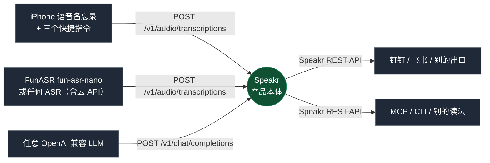

# idea-capture · 把一次口述，变成能续做的稿子

> 你有过这种时候吗：走神四十分钟，把某个系统的架构、取舍、下一步全想通了；几周后再想起来，只剩一句「我好像想清楚过」。
>
> 这个仓库就是那条缺失的出口：**说出来的推演被自动收下、自动出稿、自动送到手机**，而且能被 agent 读回去。

它不是一个新的笔记产品。它是**一份组合方案**：把本来互不相干的开源能力接成一条链，
让「躺床上想通的东西」在几分钟内变成一份能照着续做的稿子。

**这份仓库里没有一行是别人产品的替代品**——Speakr 是别人的产品，FunASR 是别人的引擎，
钉钉文档是别人的服务。我们做的事情只有两件：决定它们怎么接，以及写那几个本来不存在的零件（桥接、MCP）。

## 全景

整条链上只有三种接口，所以**每一格都可以被换掉**：

| 接口 | 谁在用 | 换成别的要满足什么 |
| --- | --- | --- |
| OpenAI 兼容 `/v1/audio/transcriptions` | Speakr ← ASR | 能返回文本就行（本地、云、别人的中转都行） |
| OpenAI 兼容 `/v1/chat/completions` | Speakr ← LLM | 能按提示词写长中文、不触发内容审核 |
| Speakr REST API | 钉钉桥接、MCP ← Speakr | 能按 token 读回「标题 + 正文 + 时间」 |

不确定的话：我们把每一格都至少试过一个替代品，各目录的 README 里写了换掉它需要什么。

## 五个目录，各管一段

| 目录 | 它解决什么 | 独立可用吗 | 换掉它的代价 |
| --- | --- | --- | --- |
| [`speakr/`](speakr/) | 产品本体：上传 → 转写 → 出稿 → 归档 → API | 是（只需要两个上游地址） | 得另找一个既出稿又有 API 的产品 |
| [`asr/`](asr/) | 转写：把音频变成中文文本 | 是（任何 OpenAI 客户端都能调） | 换成云 API 只改三行环境变量 |
| [`iphone/`](iphone/) | 采集：说完的东西怎么交出音频文件 | 是（只是个 POST） | 安卓 / 手表 / 桌面自己找录音来源 |
| [`dingtalk/`](dingtalk/) | 出口：稿子写进钉钉文档并单聊发链接 | 是（只需要 Speakr 的 read token） | 换平台改一个函数 |
| [`mcp/`](mcp/) | 被读：让 agent 直接检索、读取你的归档 | 是（完整代码；单测含自有数据，不入库） | 自己写个 CLI 也行，只是 agent 不会再自己找 |

[`docs/ops-log.md`](docs/ops-log.md) 是实机记录：端口、踩过的坑、实测数据——出问题时先翻它。

## 串起来之后，它变成什么

每一格单独存在时都是半成品：

- **转写服务**：只是一个端点，上传、存放、整理都得自己写。
- **Speakr**：能转写能出稿，但录音得从网页拖进去，转写质量取决于你接谁，稿子只能在网页里看。
- **钉钉文档**：写得再好也没有东西往里喂。
- **MCP**：没有归档可读。

接成一条链之后，得到的是一件完整的事：**一次口述，几分钟后变成一篇结构对的稿子，落在你的消息里，
并且任何 agent 都能检索到它。** 中间没有一步需要你动手——除了按下录音和最后那次分享。

## 从哪开始

| 你想要的 | 去读 |
| --- | --- |
| 先跑起来一个能录音出稿的东西 | [`speakr/`](speakr/) → [`iphone/`](iphone/) |
| 不想用云 ASR，想自己部署 | [`asr/`](asr/) |
| 想让稿子自动出现在手机上 | [`dingtalk/`](dingtalk/) |
| 想让 agent 直接读你的想法 | [`mcp/`](mcp/) |
| 想看实测数据和踩过的坑 | [`docs/ops-log.md`](docs/ops-log.md) |

每个目录都能单独读、单独跑；先挑一个，不要一次全上。

## 为什么不是现成的笔记 / 待办 / 转写工具

| 备选 | 为什么不够 |
| --- | --- |
| 待办工具 | 只装得下「动作」，装不下架构推演和取舍 |
| 笔记应用 | 记录靠自觉，事后整理成本高，等于没记 |
| 纯转写 | 拿到的是原始口语稿，仍要自己读一遍再整理 |
| 会议纪要模板 | 把深夜随记写成「验收条件：未定」，体裁错配比不写更糟 |

真正的要求是：**上传之后什么都不用做**。所以每一环都是自动的，
而「体裁」必须由模型先判断再决定结构——同一套骨架套不住所有录音。

## 设计上的几个硬决定

- **不用 webhook，用轮询**：Speakr 的 webhook 投递有 SSRF 防护，拒绝回环和私网地址。
  桥接与它同机，为了一条通知开公网入口不划算。见 [`dingtalk/`](dingtalk/)。
- **不用 Whisper 系**：训练数据里的频道口播会在静音 / 音乐段复现成「请不吝点赞订阅」，
  换壳没用，只能换模型。见 [`asr/`](asr/)。
- **提示词先判体裁**：7 类，判不准走「其他」。稿子第一行固定写 `体裁：<类型> — <依据>`。见 [`speakr/`](speakr/)。
- **MCP 不存凭据**：调用方的 Bearer 原样转给 Speakr 验一次并缓存。权限天然等于那把 token。见 [`mcp/`](mcp/)。

## 边界

- **单人实例**：没有多租户隔离，账号体系用 Speakr 自带的。
- **只读 MCP**：能查能读，不能写不能删。
- **体裁是启发式**：判不准时走「其他」，不硬套模板。
- **中文优先**：提示词、体裁、失败文案都是中文写的。
- **需要一台常开机器**：跑 Speakr（和桥接、MCP）。转写那台只在有录音时忙。
- **失败不一定看得见**：桥接只推成功出稿的；上传失败手机不报错。要可见得自己加。

## 上游清单

| 用了什么 | 我们扮演的角色 |
| --- | --- |
| [Speakr](https://github.com/murtaza-nasir/speakr)（pin `b2f897b`） | 使用者：不改一行代码，只调设置 |
| [FunASR](https://github.com/modelscope/FunASR) + `fun-asr-nano` | 使用者 + 一个 Dockerfile |
| [dingtalk-workspace-cli](https://www.npmjs.com/package/dingtalk-workspace-cli)（`dws`） | 使用者 |
| [MCP Python SDK](https://github.com/modelcontextprotocol/python-sdk) | 使用者 + 我们写的服务（[`mcp/idea_mcp.py`](mcp/idea_mcp.py)） |
| 任意 OpenAI 兼容 LLM | 使用者 |

## License

文档与脚本：[MIT](LICENSE)。
上游项目遵循各自许可证，本仓库不对它们做任何再授权。
