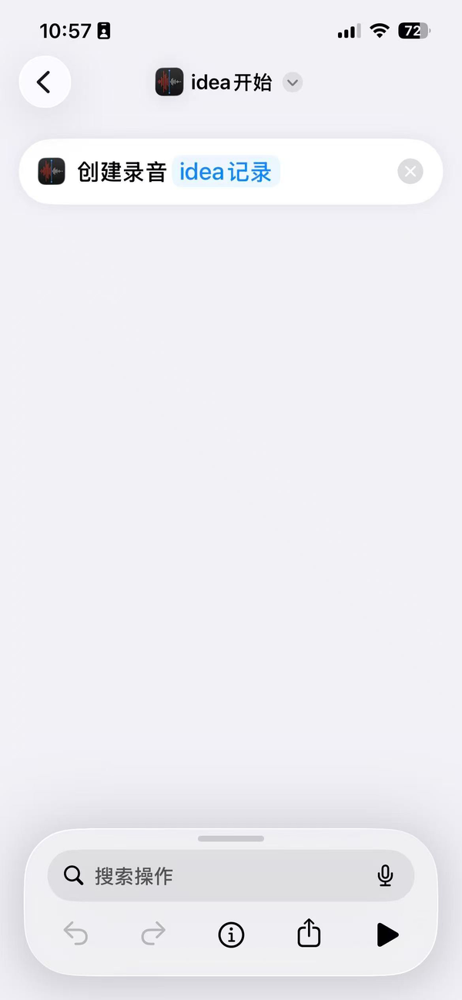
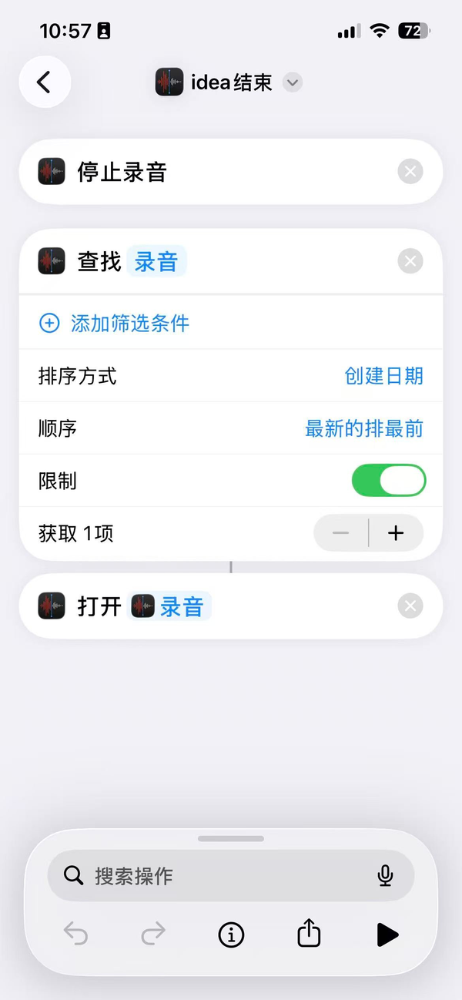
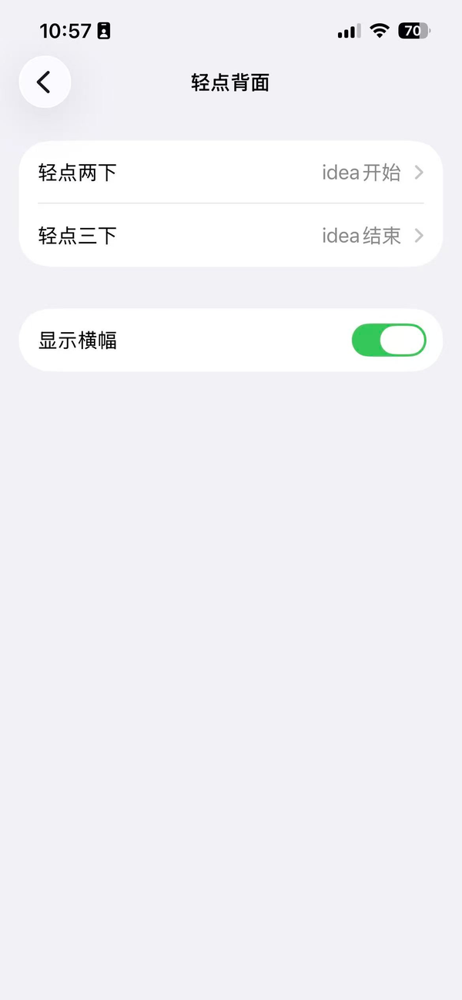
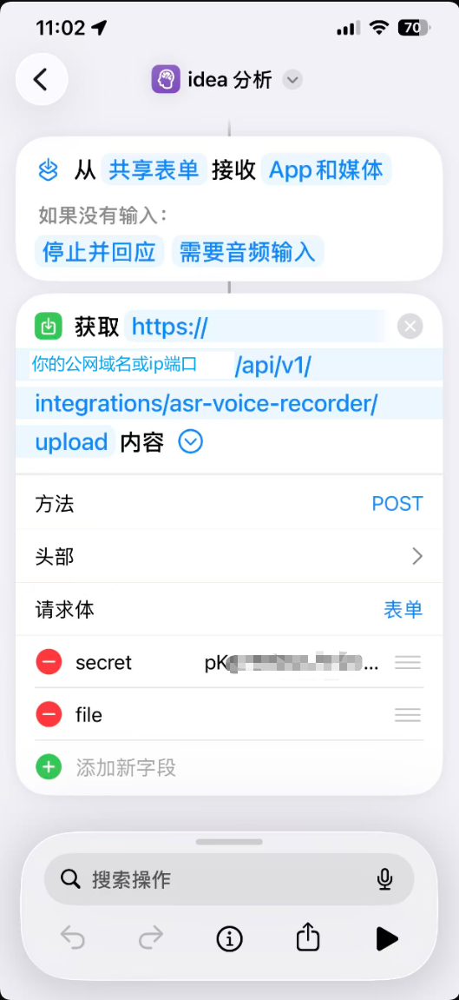
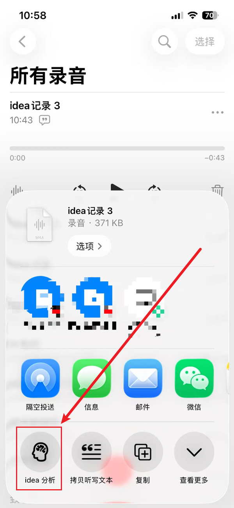

# iphone · 录音之后怎么把文件交出去

这一页解决的是「采集」：躺床上说完一段，怎么让它自己进 Speakr。

三个快捷指令，两个入口，一次手动分享。

## 三条快捷指令的分工

| 快捷指令 | 动作 | 谁触发 |
| --- | --- | --- |
| `idea 开始` | 「创建录音」（语音备忘录），录音名带上 `idea 记录` 前缀 | 轻点背面两下 |
| `idea 结束` | 「停止录音」→「查找录音」取最新一条 →「打开」它 | 轻点背面三下 |
| `idea 分析` | 从**共享表单**接收音频 → POST 到 Speakr 上传端点 | 你在语音备忘录里长按分享 |

## 为什么最后一次分享必须手动

先说清楚：**这是 iOS 的限制，不是我们没做自动。**

「查找录音」这个动作返回的是**文本**，不是音频文件——内容是那条录音的标题（约 45 字节）。
拿它去上传，服务端收到的是一个叫 `<标题>.txt` 的东西，ffmpeg 直接报
`Invalid data found when processing input`。把它「存储到文件」，落盘的也是一个 txt。

所以任何「停录 → 查找 → 自动上传」的路都走不通。唯一能拿到真音频字节的通道是**共享表单**：
语音备忘录把音频文件交给快捷指令的输入。代价是多两次点击（长按 → 分享）。

> 我们踩过这条，两个方向都验过：表单字段传进去是 45 字节文本、存储文件存出来是 txt。
> iOS 26.7.1 上确认如此。

## 1. 建一个上传用的 token

Speakr 网页 → Settings → API Tokens → 新建，勾上 **Integration (read, write, upload)**。

名字随便，比如 `iphone-upload`。**token 只显示一次**，当场复制。

这条 token 会写进快捷指令的表单字段里，所以：别把它提交进任何仓库、别截进公开图。

## 2. `idea 开始`

新建快捷指令，加一个动作：**创建录音**（语音备忘录，不是「录制音频」——那个锁屏就断）。

给录音起个固定前缀，方便之后识别。

## 3. `idea 结束`

三个动作，顺序不能换：

1. **停止录音** —— 结束手上那条；
2. **查找录音** —— 排序「创建日期」、顺序「最新排前」、限制**取 1 项**，拿到刚停的那条；
3. **打开** —— 打开刚找到的那条（会跳到语音备忘录）。

跳过去之后，长按那条录音 → 分享 → `idea 分析`。

## 4. 绑到背面轻点

设置 → 辅助功能 → 触控 → 轻点背面：两下 = `idea 开始`，三下 = `idea 结束`。

不灵就退化成桌面图标，不影响流程。

## 5. `idea 分析`（真正的上传）

1. 快捷指令详情里打开 **「在共享表单中显示」**，接收类型选媒体 / 音频；
2. 加一个动作：**获取 URL 内容**——
   - URL：`https://<你的域名>/api/v1/integrations/asr-voice-recorder/upload`
   - 方法：**POST**
   - 请求体：**表单**
   - 字段 `secret`（文本）：上一步那把 token
   - 字段 `file`（文件）：插入**快捷指令输入**

用起来是这样：语音备忘录里长按录音 → 分享 → 点 `idea 分析`。

## 三个必须知道的行为

1. **上传成功不等于出稿成功。** 上传只返回「收到」，转写和出稿在服务端排队跑。
   稿子好了由桥接推到你手机（见 `../dingtalk/`），不用在网页上等。
2. **一次上传就把每分钟配额吃满。** Speakr 的限流约 520 单位/分钟，一次上传基本占满。
   连点两下会拿到 429——这不是坏了，是在限流。一次推演传一次就好。
3. **失败现在看不见。** 「获取 URL 内容」的结果默认被丢掉，401 或超时手机不报错。
   想要可见，在末尾加一个「显示结果」动作——调试期建议加，日常可以删。

## 为什么不做成「一键开始、一键上传」

想过两个方向，都记在这儿：

1. **快捷指令里全自动**：卡在上面那个 iOS 限制，拿不到音频字节。
2. **自研 iOS App**：录音、上传都在自己 App 里，就没有这个问题；两个 App Intent 绑到操作按钮和背面轻点，
   体验能回到真正的「按一下开始、按一下结束并上传」。有开发者账号的话这条路是通的，
   真正要实测的是「App 没启动时 App Intent 冷拉起录音」这条系统路径。

在有人做完 App 之前，共享表单是多花两秒但确定能跑的路。

## 这个目录里有什么

| 文件 | 作用 |
| --- | --- |
| `images/01-start.png` | `idea 开始` 的全部动作 |
| `images/02-stop.png` | `idea 结束` 的全部动作与筛选条件 |
| `images/03-analyze.png` | `idea 分析` 的 URL / 方法 / 表单字段 |
| `images/04-bind.png` | 背面轻点的绑定 |
| `images/05-share.png` | 在语音备忘录里怎么触发 |
